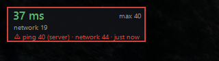

<div align="center">
  
  <h1>AionPingMeter</h1>
  <p><strong>A tiny, precise ping overlay for Aion 2 (Global)</strong></p>
  <p>See your real in-game latency, and find out instantly whether a lag spike came from <em>your PC</em>, <em>your network</em> or <em>the game server</em>.</p>

  

  <p>
    <a href="../../releases/latest"><strong>⬇ Download the latest release</strong></a>
    &nbsp;·&nbsp;
    <a href="#installation">Installation</a>
    &nbsp;·&nbsp;
    <a href="../../issues">Report a bug</a>
  </p>

  
  
  

  <p>🇬🇧 English · 🇺🇦 <a href="README.uk.md">Українська</a> · 🇷🇺 <a href="README.ru.md">Русский</a></p>
</div>

---

## Why AionPingMeter?

Most ping tools either show a number that slowly drifts away from reality, or only check your connection every few seconds and miss the hiccups you actually feel. AionPingMeter takes a different approach:

| | |
|---|---|
| 🎯 **Measured the way the game measures it** | AionPingMeter reads the game's own ping exchange with the server, the same one the client uses internally. You see the latency the game really has, not a guess based on some other connection. |
| ⏱️ **One clock, zero drift** | Send and receive times come from the same hardware timer the game itself uses. Windows clock corrections, time sync and long sessions can't add a hidden +100 ms that never goes away. The number is as true after 8 hours as after 8 seconds. |
| 🔍 **Tells you *where* the lag is** | Every spike is broken down into **PC → network → server**, so you know whether to blame your Wi-Fi, your provider, or the game. |
| 🧊 **Catches lag between measurements** | The game pings only every ~10 s. AionPingMeter also watches the server's 20 Hz update stream and the raw network round-trip continuously, so short freezes and spikes don't slip through unnoticed. |
| 📉 **Spots packet loss** | Lost and re-sent packets on the game connection are detected and reported, even if your ping looks fine. |
| 🪶 **Featherweight** | ~180 KB, about 0.005 % CPU and ~11 MB of RAM. The network driver hands it only the game's packets and ignores the rest of your traffic. |
| 🔒 **Read-only and private** | Nothing is injected into the game, no game files are touched, and AionPingMeter **never sends anything anywhere**. No accounts, no telemetry, no update pings. |
| 🔄 **Zero setup** | Finds the game, the network adapter and the right server connection by itself, and keeps following them through relogs, server transfers, Wi-Fi ↔ cable switches and VPNs. |

---

## Reading the overlay

```
38 ms              max 39      ← in-game ping · highest in the last minute
network 18                     ← pure network round-trip, updated continuously
```

| Value | Meaning |
|---|---|
| **ms** (big number) | Your **in-game ping**: the time from your client sending a request to the server's reply. It includes the trip there and back **plus** the time the server takes to process it. This is what you actually feel in game. |
| **max** | The highest in-game ping during the last minute. |
| **network** | The **pure network round-trip** to the game server, with no server processing. Updated many times per second. |

> **Good to know:** `ms` is always higher than `network`. The difference is the server's reaction time (Aion 2 servers tick every 50 ms). If `network` is calm but `ms` jumps, the issue is on the server side, not yours.

The number turns 🟢 green below 60 ms, 🟡 yellow up to 120 ms and 🔴 red above that.

---

## Lag alerts

When something goes wrong, a third line appears and lists everything that happened in the last minute:

<div align="center">
  
</div>

```
⚠ ping 1200 (server) · network 60 · freeze 450 · loss ×2 · 15s ago
```

| Alert | What happened |
|---|---|
| `ping 1200 (server)` | In-game ping spiked. The label in brackets says where the time was lost: **(server)**, **(network)** or **(PC)**. |
| `network 60` | Your connection to the server got slower. |
| `freeze 450` | The server stopped sending updates for 450 ms. This is a server-side stall, even when your network is perfect. |
| `loss ×2` | Packets were lost and had to be re-sent. Usually felt as a micro-stutter. |

- **First 10 seconds:** the line turns **red** and the overlay gets a red frame. The tray icon turns red too.
- **Up to one minute:** the line stays **orange**, so you can still see that something happened *recently*.
- **After that:** it disappears on its own.

Your current ping and network stay visible the whole time.

### Quick diagnosis

| You see… | Most likely cause |
|---|---|
| `freeze` or `ping (server)`, network calm | The game server or gateway hiccuped. Nothing to fix on your side. |
| `network` and/or `loss` | Your Wi-Fi, router, provider or route to the server. |
| `ping (PC)` | Your computer delayed the request, e.g. a CPU or disk spike. |
| You felt a lag but **no alert at all** | A local stutter (FPS drop). The server and network were fine. |

---

## Installation

### Requirements

- Windows 10 / 11 (64-bit)
- [**Npcap**](https://npcap.com/#download). If you already use another network-based meter, you probably have it.
  During setup, keep **"Restrict Npcap driver's access to Administrators only"** *unchecked*.
- [**.NET 8 Desktop Runtime**](https://dotnet.microsoft.com/download/dotnet/8.0) (x64)

### Run

1. Download **`AionPingMeter-vX.Y.Z-win-x64.zip`** from the [latest release](../../releases/latest).
2. Unzip it into any folder, for example `C:\Games\AionPingMeter`.
3. Start `AionPingMeter.exe`. Admin rights are not required.
4. Launch Aion 2. The overlay fills in automatically within ~10 seconds of entering the world.

> Windows SmartScreen may warn about an unknown publisher, because the app isn't code-signed. Click **More info → Run anyway**.

**Updating:** close AionPingMeter from the tray, unzip the new version over the old one, and start it again. Your settings are kept.

**Uninstalling:** delete the folder, and optionally `%APPDATA%\AionPingMeter` (settings and logs).

---

## Tray menu

Right-click the AionPingMeter icon next to the clock. If you don't see it, check the **^** hidden-icons area.

| Item | Action |
|---|---|
| **Server: x.x.x.x:port** | The game gateway you're connected to. Click to copy it, handy for comparing with friends. |
| **Show server in overlay** | Adds the gateway address as an extra line on the overlay. |
| **Move** / **Lock position** | Unlock the overlay, drag it anywhere, then lock it again. The position is remembered. |
| **Reset position** | Puts the overlay back in the top-left corner of the main screen. |
| **Write log** | Saves every measurement to a CSV file (see below). |
| **Alert threshold** | The ping that always raises an alert: 80 / 100 / 150 / 200 / 300 ms. Sudden jumps are flagged regardless. |
| **Exit** | Closes AionPingMeter. |

**Hover** over the tray icon to see session counters:

```
AionPingMeter · 203.0.113.42:12000
pings 412 · loss 0 · freeze 1
gateway changes 0
```

The tray icon is colour-coded as well (grey / green / yellow / red), so you can check your connection even when the overlay is hidden.

The overlay never takes focus and lets every click go through to the game.

---

## Logging

With **Write log** enabled, AionPingMeter appends to:

```
%APPDATA%\AionPingMeter\ping-log.csv
```

```csv
time,ping_ms,pc_ms,network_ms,server_ms,gateway
2026-01-15 20:31:04.512,39.4,1.0,19.0,19.4,203.0.113.42:12000
2026-01-15 20:31:15.268,freeze,4290,,,,203.0.113.42:12000
2026-01-15 20:31:15.341,863.9,1.0,18.9,844.0,203.0.113.42:12000
```

The log opens in Excel or Google Sheets. It's useful for spotting patterns, like lag at peak hours or on a specific gateway, and for backing up a support ticket with exact timestamps.

---

## FAQ

**Can I get banned for this?**
AionPingMeter only *observes* network traffic, the same way Wireshark does. It doesn't touch the game process, memory or files, and it doesn't modify or send any packets. That said, third-party tools are always used at your own discretion.

**Does it work on Korea / Taiwan servers?**
Not at the moment. Those regions use a different timestamp format, so the overlay will show `—`. Global (EU/NA) is supported.

**Does it work with a VPN or a game accelerator?**
Yes. AionPingMeter follows the game's connection on whatever adapter it uses.

**The overlay shows `— ms`.**
Make sure Npcap is installed and the game is running and you're in the world. The first value appears with the game's next ping, within about 10 seconds.

**Why is my in-game ping about 20 ms higher than `network`?**
That's the server's processing time. The server handles requests on a 50 ms tick, so a request waits 0–50 ms for its turn. This is normal and the same for everyone.

**My friends had a lag spike and I didn't, even though we were in the same place. How?**
Players are often served by different gateways. Compare the **Server** address in the tray menu: if theirs differs from yours, that gateway stalled, not the whole game.

---

## Building from source

You need the [.NET 8 SDK](https://dotnet.microsoft.com/download/dotnet/8.0).

```
git clone <this repository>
cd AionPingMeter
dotnet build -c Release -o out
```

The app ends up in `out\AionPingMeter.exe`. The whole program is a single file, [`Program.cs`](Program.cs).

## License

[MIT](LICENSE)

---

<div align="center">
  <sub>AionPingMeter is an independent fan-made tool and is not affiliated with or endorsed by NCSOFT. Aion is a trademark of NCSOFT Corporation.</sub>
</div>
